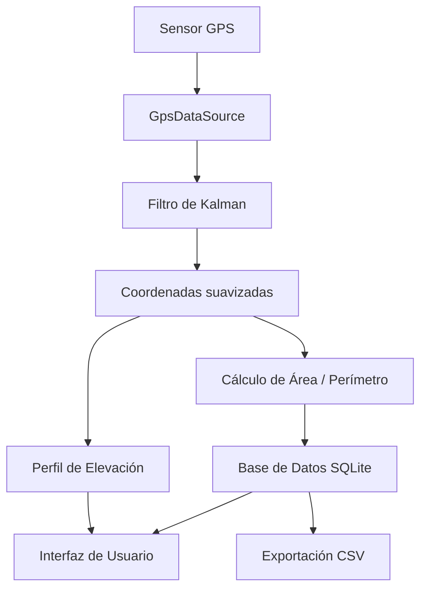
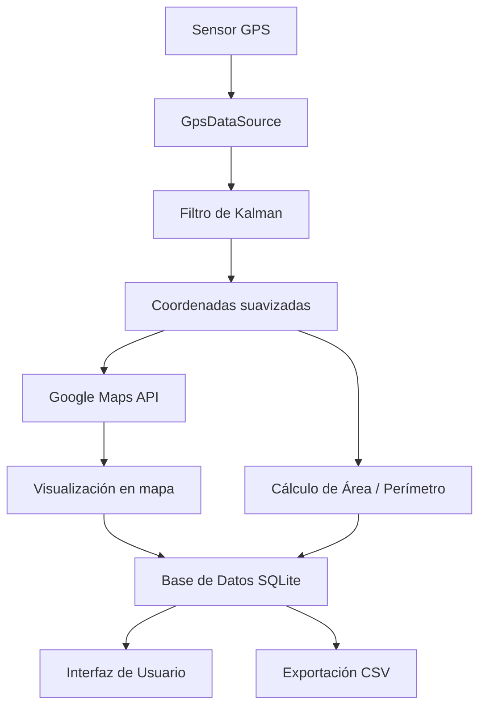

# Documento de Arquitectura — PrediGeo

## 1. Visión General

PrediGeo es una aplicación móvil Flutter que sigue una arquitectura offline-first basada en tres capas principales: **data**, **domain** y **presentation**. La aplicación utiliza Riverpod para la gestión de estado y go_router para la navegación declarativa.

## 2. Capas de la Arquitectura

### 2.1 Capa de Datos (Data)

La capa de datos es responsable de:

- Acceso a la base de datos SQLite mediante DAO (Data Access Objects)
- Implementación de repositorios que abstraen las fuentes de datos
- Captura de datos GPS mediante el sensor del dispositivo
- Almacenamiento y recuperación de mediciones
- Exportación de datos en formato CSV
- Gestión de caché de mapas

**Componentes principales:**

- `GpsDataSource`: Captura coordenadas del sensor GPS
- `MeasurementRepository`: Repositorio de mediciones
- `PointRepository`: Repositorio de puntos GPS
- `DatabaseHelper`: Gestor de la base de datos SQLite
- `CsvExporter`: Exportador de datos en formato CSV

Detalle del esquema local (tablas `measurements`, `measurement_points`,
`field_evaluations`, índices, claves foráneas y versionado) en
[`modelo_er.md`](modelo_er.md).

### 2.2 Capa de Dominio (Domain)

La capa de dominio contiene la lógica de negocio de la aplicación:

- Entidades del dominio (Measurement, GpsPoint, Polygon)
- Casos de uso (CapturePoints, CalculateArea, CalculatePerimeter, FilterGpsSignal)
- Modelos de precisión y evaluación
- Interfaces de repositorios (contratos)

**Componentes principales:**

- `Measurement`: Entidad que representa una sesión de medición
- `GpsPoint`: Entidad que representa un punto GPS con latitud, longitud y altitud
- `CalculateAreaUseCase`: Cálculo de área mediante fórmula de Gauss
- `CalculateDistanceUseCase`: Cálculo de distancia mediante fórmula de Haversine
- `KalmanFilter`: Implementación del filtro de Kalman para suavizado GPS
- `AccuracyEvaluator`: Evaluación de precisión (error absoluto, porcentual, RMSE)

### 2.3 Capa de Presentación (Presentation)

La capa de presentación maneja la interfaz de usuario:

- Pantallas (pages) y widgets reutilizables
- Providers de Riverpod para gestión de estado
- Controladores de vista (ViewModels)
- Temas y estilos de la aplicación
- Navegación mediante go_router

**Componentes principales:**

- `HomeScreen`: Pantalla principal con mapa y controles
- `MeasurementScreen`: Pantalla de captura de medición
- `HistoryScreen`: Pantalla de historial de mediciones
- `ElevationProfileScreen`: Pantalla de perfil de elevación
- `SettingsScreen`: Pantalla de configuración
- Providers: `measurementProvider`, `gpsProvider`, `historyProvider`

## 3. Flujo de Datos

### 3.1 Flujo sin conexión (Offline)



### 3.2 Flujo con conexión (Online)



## 4. Patrones de Diseño

### 4.1 Gestión de Estado — Riverpod

La aplicación utiliza Flutter Riverpod como gestor de estado:

- **StateProvider**: Para estados simples y mutables
- **FutureProvider**: Para operaciones asíncronas (consultas a SQLite)
- **StreamProvider**: Para flujos de datos en tiempo real (señal GPS)
- **NotifierProvider**: Para lógica de estado compleja

Ejemplo de estructura de providers:

```dart
final gpsStreamProvider = StreamProvider<GpsPoint>((ref) {
  return ref.watch(gpsDataSourceProvider).gpsStream;
});

final measurementProvider = StateNotifierProvider<MeasurementNotifier, MeasurementState>((ref) {
  return MeasurementNotifier(
    ref.watch(measurementRepositoryProvider),
  );
});

final historyProvider = FutureProvider<List<Measurement>>((ref) async {
  return ref.watch(measurementRepositoryProvider).getAllMeasurements();
});
```

### 4.2 Navegación — go_router

La aplicación utiliza go_router para la navegación declarativa:

- Definición de rutas anidadas
- Redirección basada en estado de autenticación o permisos
- Soporte para deep linking
- Transiciones personalizadas entre pantallas

Ejemplo de configuración de rutas:

```dart
final routerProvider = Provider<GoRouter>((ref) {
  return GoRouter(
    initialLocation: '/',
    routes: [
      GoRoute(path: '/', builder: (context, state) => const HomeScreen()),
      GoRoute(path: '/measurement', builder: (context, state) => const MeasurementScreen()),
      GoRoute(path: '/history', builder: (context, state) => const HistoryScreen()),
      GoRoute(path: '/elevation-profile', builder: (context, state) => const ElevationProfileScreen()),
      GoRoute(path: '/settings', builder: (context, state) => const SettingsScreen()),
    ],
  );
});
```

## 5. Estructura de Directorios

```
lib/
├── main.dart
├── app_theme.dart
├── router.dart
├── core/
│   ├── constants/
│   ├── utils/
│   └── errors/
├── data/
│   ├── datasources/
│   ├── models/
│   └── repositories/
├── domain/
│   ├── entities/
│   ├── repositories/
│   └── usecases/
└── presentation/
    ├── providers/
    ├── screens/
    └── widgets/
```

## 6. Motor de Cálculo de Área

### 6.1 Proyección Local (GeoProjector)

El cálculo de área se realiza sobre coordenadas planas obtenidas mediante proyección local sobre el elipsoide GRS80 (equivalente a MAGNA-SIRGAS). La proyección utiliza el centroide del polígono como origen:

```
x = R · cos(lat₀) · (lon - lon₀)
y = R · (lat - lat₀)
```

Donde:
- `R` = radio de curvatura local del elipsoide GRS80 (a = 6 378 137 m, f = 1/298.257222101)
- `lat₀, lon₀` = centroide del polígono (origen de la proyección)
- `lat, lon` = coordenadas del punto a proyectar

**Error esperado:** Para predios de hasta ~100 ha (1 km²), el error de proyección es < 0.1 % debido a que la distorsión del plano tangente es despreciable a esta escala.

### 6.2 Fórmula de Gauss (Shoelace)

El área se calcula con la fórmula de Gauss (shoelace):

```
A = ½ |Σ(xᵢ · yᵢ₊₁ - xᵢ₊₁ · yᵢ)|
```

Donde los puntos están ordenados en sentido horario o antihorario y el último punto se conecta con el primero.

### 6.3 Validación de Polígonos

Antes del cálculo, se valida:
- Mínimo 3 puntos
- Sin puntos duplicados consecutivos
- Sin auto-intersección de lados (detección de segmentos que se cruzan)

### 6.4 Unidades de Área

Conversión a unidades usadas en Colombia:
- 1 hectárea = 10 000 m²
- 1 fanegada = 6 400 m²
- 1 plaza = 6 400 m²
- 1 cuadra = 6 400 m² (uso regional)

## 8. Vista 3D del relieve (offline)

PrediGeo genera una superficie de terreno en 3D de forma **local**, a partir
de los puntos GNSS capturados (latitud, longitud y altitud), sin depender de
servicios externos ni de un modelo digital de elevación (DEM).

### 8.1 Generación de la superficie

1. Se descartan los puntos con precisión horizontal mayor a 20 m o con
   altitud no válida (`NaN` / infinito).
2. Si quedan menos de 3 puntos válidos se devuelve un resultado de tipo
   `track` (fallback a línea/trayecto) o `unavailable` (sin superficie).
3. Los puntos se proyectan al plano en metros mediante `GeoProjector`
   (centroide como origen) y se verifica que no sean colineales.
4. Se calcula la altitud relativa al punto más bajo del recorrido.
5. Se triangula la nube de puntos con Delaunay (Bowyer-Watson) en Dart puro,
   generando una malla TIN (triangulated irregular network).
6. La malla se renderiza con un `CustomPainter` propio, coloreando cada
   triángulo por altura (paleta hipsométrica) y añadiendo un sombreado simple
   por orientación.

### 8.2 Limitaciones de precisión vertical

- La altitud reportada por el GPS del dispositivo tiene **menor precisión**
  que la posición horizontal (típicamente ±5 a ±15 m en campo abierto).
- La superficie es una **representación aproximada** del relieve real: no
  sustituye un levantamiento topográfico ni un DEM.
- Por eso la aplicación muestra siempre el aviso:
  *"Representación aproximada: la altitud del GPS tiene menor precisión que la
  horizontal"*.
- El control de exageración vertical (1x, 2x, 5x, 10x) permite hacer visible
  el relieve en terrenos casi planos, pero no aumenta la precisión real.

### 8.3 Funcionamiento sin internet

- La vista 3D se calcula y renderiza completamente en el dispositivo.
- No requiere conexión, mapas base ni claves de API.
- Está disponible tanto en la captura (sección de relieve sin conexión) como
  en el detalle de una medición guardada, siempre que existan puntos con
  altitud.
